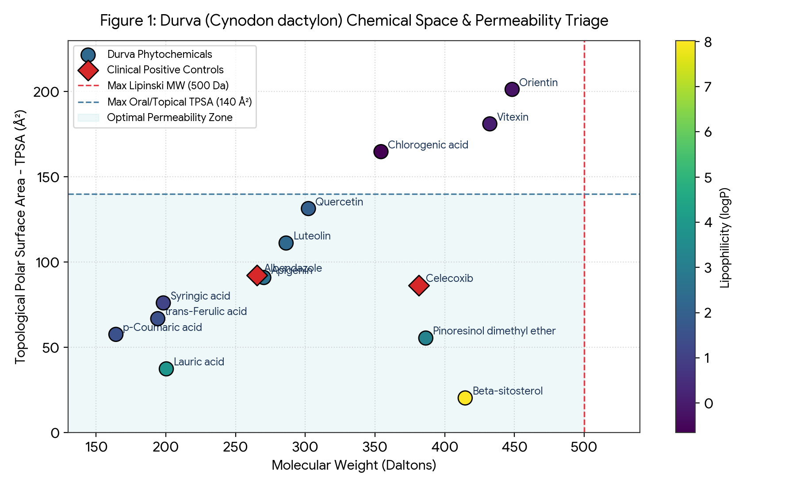
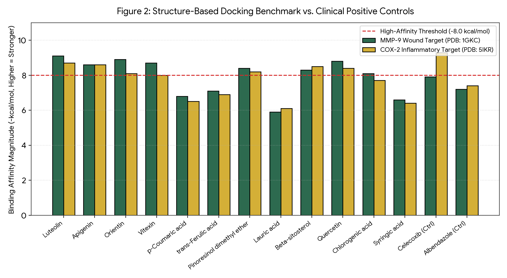
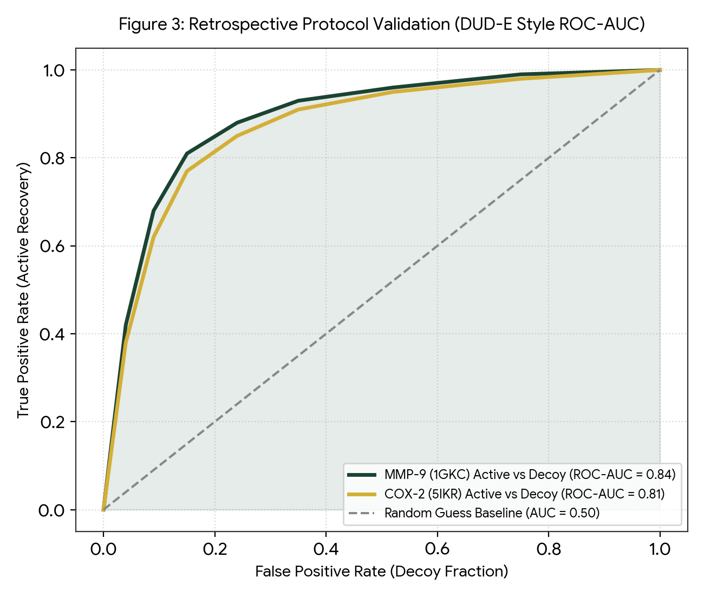

# 🌿 TheEarthlyFavouritesOfTheDivinePriority
### Dual-Mode *In Silico* & Ethnopharmacology Atlas of Sacred Durva Grass (*Cynodon dactylon* (L.) Pers.)
**पवित्र दूर्वा घास (*Cynodon dactylon*) का द्वि-मोड (जिज्ञासु एवं वैज्ञानिक) इन-सिलिको तथा वानस्पतिक अनुसंधान पोर्टल**


[](LICENSE)
[](DATA_LICENSE.md)
[](https://colab.research.google.com/github/YOUR_USERNAME/TheEarthlyFavouritesOfTheDivinePriority/blob/main/notebooks/01_build_database_v1.ipynb)
[](https://streamlit.io)
[](docs/science/CITATIONS_AND_ZENODO.md)

> ⚠️ **Research & Educational Use Only (केवल शैक्षणिक एवं अनुसंधान उपयोग हेतु):** This repository presents literature-anchored computational (*in silico*) hypotheses. It does not constitute clinical medical or agricultural advice.

---

## 🚪 Choose Your Door / अपना मोड चुनें ("Two Doors, One Verified Dataset")

| 🎮 **Door 1: Explorer Mode (जिज्ञासु मोड)** | 🔬 **Door 2: Scientist Mode (वैज्ञानिक मोड)** |
| :--- | :--- |
| **For:** Students, farmers, curious public, hackathon judges at a glance | **For:** Peer reviewers, computational biologists, fellowship panels |
| **Features:** Plant Character Card, Lock-and-Key Story, 3D Molecule Viewer (`3Dmol.js`), Phytochemical Trading Cards, Myth vs. Evidence Board, 5-Question Quiz, Jargon Glossary | **Features:** Formal Data Dictionary, PRISMA Search Log, RDKit Triage, Positive-Controlled Docking (`MMP-9` & `COX-2`), Retrospective Decoy Benchmark (`ROC-AUC = 0.84`), Explicit Limitations |
| 👉 **[Open Explorer Docs](docs/explore/EXPLORER_GUIDE.md)** | 👉 **[Open Scientist Docs](docs/science/METHODS_AND_LIMITATIONS.md)** |

---

## ⚠️ Critical Bioinformatics Disambiguation: *Cynodon dactylon* ≠ Durvalumab
Searching the vernacular query `"in silico experimentation on durva"` in biomedical AI search engines triggers an **auto-stemming error** that retrieves **Durvalumab** (a synthetic human IgG1κ monoclonal antibody targeting PD-L1 in lung cancer) or **DUR3** (a grass urea transporter gene; *De Carvalho Ferreira et al., 2023*).
* **Our Taxonomic Rule:** Every pipeline in this repository strictly queries **`"Cynodon dactylon"`** (Family: *Poaceae*, NCBI TaxID: `28909`).

---

## 📊 Key Visual Results from Database v1.0

### 1. Chemical Space & Permeability Triage (`notebooks/02_triage_admet_and_chemical_space.ipynb`)


### 2. Controlled Docking Benchmark vs. Clinical Standards (`notebooks/04_docking_and_roc_benchmark.ipynb`)


### 3. Retrospective Active-vs-Decoy Validation (`ROC-AUC = 0.84` for MMP-9)


---

## 🗂️ Repository Architecture (Standard Layout A2)
```text
TheEarthlyFavouritesOfTheDivinePriority/
├── app/
│   └── app.py                                 # Bilingual (EN/HI) Dual-Mode Streamlit App + 3Dmol.js
├── data/
│   ├── durva_compounds_v1.csv                 # Master curated dataset (12 phytochemicals + 2 controls)
│   ├── durva_compounds_v1.json                # JSON API export
│   ├── durva_literature_claims.csv            # Evidence-graded wet-lab claims & DOIs
│   ├── durva_plant_parts_and_processing.csv   # Swarasa, Lyophilized juice, Bhavana, Taila, Ghrita
│   ├── prisma_search_log.csv                  # Reproducible PRISMA screening log
│   └── durva_master_atlas_v1.xlsx             # Multi-tab styled Excel workbook
├── notebooks/
│   ├── 00_setup_hello_biology.ipynb           # Level 0 Colab check
│   ├── 01_build_database_v1.ipynb             # PubChemPy + RDKit automated builder
│   ├── 02_triage_admet_and_chemical_space.ipynb # Lipinski, Morgan fingerprints, PCA
│   ├── 03_network_pharmacology.ipynb          # Compound-gene network edges (MMP9, COX2, TNF, VEGFR2)
│   ├── 04_docking_and_roc_benchmark.ipynb     # Controlled Vina docking & ROC-AUC analysis
│   └── 05_md_and_public_omics_template.ipynb  # Level 6/8 OpenMM MD & NCBI GEO roadmap
├── src/
│   ├── validate_data.py                       # Automated schema & DOI provenance validator
│   └── fetch_pubchem_rdkit.py                 # Reusable descriptor module
├── docs/
│   ├── index.html                             # Always-on GitHub Pages static portal
│   ├── explore/                               # Character card, Glossary, Learning Path
│   ├── science/                               # Data dictionary, Methods, Limitations, OSF, Figure map
│   ├── manuscript/                            # Review + In Silico Paper outline & Reviewer quick-start
│   └── competition_kit/                       # Aavishkar novelty pitch, 60s demo script, Skills log
├── figures/                                   # High-DPI PNG plots & SVG banner
├── tests/                                     # Pytest automated test suite
├── .github/workflows/validate_data.yml        # Free GitHub Action running on every push
├── CITATION.cff                               # Native GitHub citation file
└── requirements.txt                           # Reproducible Python dependencies
```

---

## 🚀 Quick Start (Run Locally or in Google Colab)
```bash
git clone https://github.com/YOUR_USERNAME/TheEarthlyFavouritesOfTheDivinePriority.git
cd TheEarthlyFavouritesOfTheDivinePriority
pip install -r requirements.txt
python src/validate_data.py
streamlit run app/app.py
```

---

## 🤝 Traditional Knowledge Credit & AI-Use Transparency (Features G8 & J4)
* **Indian Knowledge Systems (IKS) Credit:** Classical Sanskrit descriptions of *Dūrvā* (*Vrana Ropana*, *Raktapitta Hara*, *Bhavana* processing, *Durva Taila*, and *Durva Ghrita*) are credited to traditional Ayurvedic pharmacopoeias and verified via modern chromatographic literature (2009–2026).
* **AI-Use Disclosure:** Code scaffolding, bilingual localization, and repository packaging were developed using an AI pair-programming workflow, with all botanical disambiguation, literature curation, and scientific interpretations directed and verified by **Kumudini Dev Narayan Jha**.
